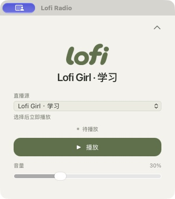

<p align="center">
  
</p>
<h1 align="center">Lofi Radio</h1>
<p align="center">A little music. A little focus.</p>
<p align="center">A quiet live lofi player for the macOS menu bar and Windows system tray.</p>
<p align="center">
  <a href="https://github.com/cnlutong/Lofi-Radio/releases/latest"></a>
  
  
  <a href="LICENSE"></a>
</p>
<p align="center"><strong>English</strong> · <a href="README.zh-CN.md">简体中文</a></p>

---

### Your music, within reach

- **15 live stations** for studying, unwinding, and late nights.
- **One click to play or pause.** Right-click the menu bar or tray icon for stations, volume, and the player panel.
- **Quiet in the background.** Closing the panel keeps the music playing; your station and volume are remembered.
- **Ready to listen.** Playback dependencies are bundled in the installer.

<p align="center">
  
</p>

### Download

Version 0.2.0 supports these platforms. The app interface is in Simplified Chinese.

| System | Installer |
| --- | --- |
| macOS 27 or later on Apple Silicon | `aarch64.dmg` |
| Windows 10 or 11 on x64 | `x64-setup.exe` |

**macOS** · Open the DMG, drag **Lofi Radio** into **Applications**, then launch it. Click **lofi** in the menu bar to start listening. The installer uses ad-hoc signing. If macOS blocks it, use **System Settings → Privacy & Security → Open Anyway**. [Apple’s guide](https://support.apple.com/en-us/102445)

**Windows** · Run the installer and open **Lofi Radio** from Start. Closing the panel leaves the icon in the taskbar notification area. The installer can download WebView2 when needed. Windows may show a SmartScreen prompt for the unsigned installer.

Start playback manually after launch. Pausing disconnects the stream, and resuming reconnects to the live broadcast. The tray menu can keep the computer awake during playback while allowing the display to sleep.

[All releases & checksums](https://github.com/cnlutong/Lofi-Radio/releases) · [Report an issue](https://github.com/cnlutong/Lofi-Radio/issues)

<details>
<summary><strong>Stations</strong></summary>

Live streams from [Lofi Girl](https://www.youtube.com/@LofiGirl/streams), [Chillhop Music](https://www.youtube.com/@ChillhopMusic/streams), [The Bootleg Boy](https://www.youtube.com/@thebootlegboy/streams), [Homework Radio](https://www.youtube.com/@HomeworkRadio/streams), [Chill with Taiki](https://www.youtube.com/@ChillwithTaiki/streams), [Purrple Cat](https://www.youtube.com/@PurrpleCat/streams), [Tokyo LoFi Girls](https://www.youtube.com/channel/UCuk4aLkedGhikPosDKyGHAQ/streams), and [Midnight Convenience](https://www.youtube.com/channel/UCQDU0vUP3-Y0nlP0X3ZNCBw/streams).

This app uses unofficial YouTube playback and does not distribute music files. Streams can change or go offline; update the app if playback stops working. Automatic reconnection after network loss or system sleep is not yet supported.

</details>

<details>
<summary><strong>Development & building</strong></summary>

Built with Tauri 2, Rust 2024, TypeScript 6, Vite 8, and CSS. mpv uses AVFoundation on macOS and WASAPI on Windows. Development requires Node.js 22.12+ and stable Rust.

**macOS** · Use macOS 27+ on Apple Silicon with Xcode 27 Command Line Tools and Homebrew.

```sh
xcode-select --install  # Skip if already installed
brew install rust mpv yt-dlp deno
npm ci
npm run tauri dev
```

```sh
npm test           # Offline player and settings checks
npm run build     # TypeScript checks and frontend build
npm run test:live # Live playback checks; briefly plays at 10% volume
npm run tauri build
```

The local app is at `src-tauri/target/release/bundle/macos/Lofi Radio.app` and uses the playback dependencies installed on your Mac. To build a self-contained installer instead:

```sh
brew install mpv deno python@3.14
npm run release:prepare
npm run release:build
```

macOS installers are written to `src-tauri/target/release/bundle/dmg/`. Bundled dependencies are checked against the macOS 27 baseline.

**Windows** · Install Visual Studio C++ Build Tools with the Windows SDK, WebView2, Python 3.12+, and MSYS2. Install mpv and binutils from the MSYS2 UCRT64 terminal.

```sh
pacman -Syu
pacman -S mingw-w64-ucrt-x86_64-mpv mingw-w64-ucrt-x86_64-binutils
```

Run these commands from the project directory in PowerShell, adjusting `C:/msys64` for your installation.

```powershell
npm ci
npm run release:prepare:windows -- --msys-root C:/msys64
npm run tauri dev
npm test
npm run release:build:windows
```

Windows installers are written to `src-tauri/target/release/bundle/nsis/`. Pushing a matching `v*` version tag builds and verifies both platforms on their respective runners and publishes the installers, checksums, and third-party source archives. [Release workflow](.github/workflows/release.yml)

Settings and playback logs live in `~/Library/Application Support/com.lofiradio.desktop/` on macOS and `%APPDATA%\com.lofiradio.desktop\` on Windows. [Branding assets](assets/)

</details>

### License

Project code is available under the [MIT License](LICENSE). Music and third-party brands belong to their respective owners.

Bundled dependencies retain their own licenses, including GPL/LGPL for mpv and some of its dependencies. License and version records are in `Contents/Resources/runtime/licenses/` on macOS and `runtime\licenses\` in the Windows installation directory. Each platform’s `third-party-sources` archive contains corresponding source, patches, and build recipes.
