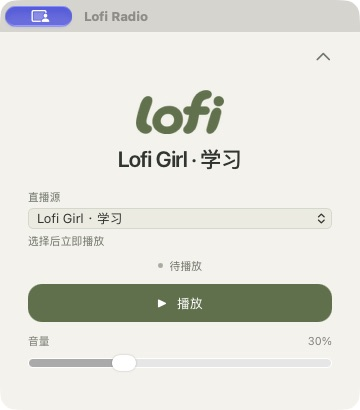

<p align="center">
  
</p>
<h1 align="center">Lofi Radio</h1>
<p align="center">一点音乐，一点专注。</p>
<p align="center">安静待在 macOS 菜单栏和 Windows 托盘里的 lofi 直播播放器。</p>
<p align="center">
  <a href="https://github.com/cnlutong/Lofi-Radio/releases/latest"></a>
  
  
  <a href="LICENSE"></a>
</p>
<p align="center"><a href="README.md">English</a> · <strong>简体中文</strong></p>

---

### 音乐，触手可及

- **15 个直播电台**，陪你学习、放松，也陪你度过深夜。
- **单击播放或暂停。** 右键点击菜单栏或托盘图标，即可切换电台、调整音量或打开面板。
- **安静地留在后台。** 收起面板，音乐继续；电台与音量会自动记住。
- **安装即可收听。** 播放依赖已包含在安装包内。

<p align="center">
  
</p>

### 下载

从 v0.2.0 起支持以下平台。应用界面使用简体中文。

| 系统 | 安装包 |
| --- | --- |
| macOS 27 或更新版本，Apple 芯片 | `aarch64.dmg` |
| Windows 10 或 11，x64 | `x64-setup.exe` |

**macOS** · 打开 DMG，将 **Lofi Radio** 拖入「应用程序」，然后启动。在菜单栏点击 **lofi** 即可播放。安装包采用 ad-hoc 签名。若被 macOS 拦截，在「系统设置 → 隐私与安全性」选择「仍要打开」。[Apple 说明](https://support.apple.com/zh-cn/102445)

**Windows** · 运行安装程序，再从开始菜单打开 **Lofi Radio**。关闭面板后，图标留在任务栏通知区域，可能需要展开隐藏图标。安装程序会在需要时联网安装 WebView2。安装包未使用发行者证书签名，可能出现 SmartScreen 提示。

每次启动后手动开始播放。暂停会断开直播，再次播放时重新连接。托盘菜单中的「播放时电脑不休眠」会阻止电脑因闲置而休眠，同时允许显示器进入睡眠。

[全部版本与校验文件](https://github.com/cnlutong/Lofi-Radio/releases) · [反馈问题](https://github.com/cnlutong/Lofi-Radio/issues)

<details>
<summary><strong>电台来源</strong></summary>

直播来自 [Lofi Girl](https://www.youtube.com/@LofiGirl/streams)、[Chillhop Music](https://www.youtube.com/@ChillhopMusic/streams)、[The Bootleg Boy](https://www.youtube.com/@thebootlegboy/streams)、[Homework Radio](https://www.youtube.com/@HomeworkRadio/streams)、[Chill with Taiki](https://www.youtube.com/@ChillwithTaiki/streams)、[Purrple Cat](https://www.youtube.com/@PurrpleCat/streams)、[Tokyo LoFi Girls](https://www.youtube.com/channel/UCuk4aLkedGhikPosDKyGHAQ/streams) 和 [Midnight Convenience](https://www.youtube.com/channel/UCQDU0vUP3-Y0nlP0X3ZNCBw/streams)。

应用使用非官方 YouTube 播放方式，不分发音乐文件。直播可能停播或更换链接；播放失效时请更新应用。暂不支持断网或系统睡眠后的自动重连。

</details>

<details>
<summary><strong>开发与构建</strong></summary>

使用 Tauri 2、Rust 2024、TypeScript 6、Vite 8 和 CSS 构建。mpv 在 macOS 上使用 AVFoundation，在 Windows 上使用 WASAPI。开发需要 Node.js 22.12+ 和 Rust stable。

**macOS** · 在 Apple 芯片 Mac 上安装 macOS 27+、Xcode 27 Command Line Tools 和 Homebrew。

```sh
xcode-select --install  # 已安装时跳过
brew install rust mpv yt-dlp deno
npm ci
npm run tauri dev
```

```sh
npm test           # 播放器与设置的离线检查
npm run build     # TypeScript 检查与前端构建
npm run test:live # 真实直播检查，会短暂以 10% 音量播放
npm run tauri build
```

本地应用位于 `src-tauri/target/release/bundle/macos/Lofi Radio.app`，使用这台 Mac 上安装的播放依赖。构建包含全部播放依赖的安装包：

```sh
brew install mpv deno python@3.14
npm run release:prepare
npm run release:build
```

macOS 安装包输出到 `src-tauri/target/release/bundle/dmg/`。内置依赖按 macOS 27 的最低要求检查。

**Windows** · 安装 Visual Studio C++ 生成工具（含 Windows SDK）、WebView2、Python 3.12+ 和 MSYS2。在 MSYS2 的 UCRT64 终端安装 mpv 和 binutils。

```sh
pacman -Syu
pacman -S mingw-w64-ucrt-x86_64-mpv mingw-w64-ucrt-x86_64-binutils
```

然后在 PowerShell 中从项目目录运行以下命令。按实际安装位置调整 `C:/msys64`。

```powershell
npm ci
npm run release:prepare:windows -- --msys-root C:/msys64
npm run tauri dev
npm test
npm run release:build:windows
```

Windows 安装包输出到 `src-tauri/target/release/bundle/nsis/`。推送与应用版本匹配的 `v*` 标签后，两端分别在对应系统上构建和验证，随后一起发布安装包、校验文件和第三方源码归档。[发布工作流](.github/workflows/release.yml)

设置与播放日志在 macOS 上位于 `~/Library/Application Support/com.lofiradio.desktop/`，在 Windows 上位于 `%APPDATA%\com.lofiradio.desktop\`。[品牌素材](assets/)

</details>

### 许可证

项目代码采用 [MIT 许可证](LICENSE) 开源。音乐与第三方品牌的权利归各自权利人所有。

内置依赖遵循各自的许可证，包括 mpv 及其部分依赖使用的 GPL/LGPL。许可证及版本记录位于 macOS 应用的 `Contents/Resources/runtime/licenses/` 或 Windows 安装目录的 `runtime\licenses\`。对应源码、补丁和构建配方随各平台的 `third-party-sources` 归档提供。
