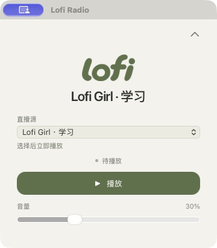

<p align="center">
  
</p>
<h1 align="center">Lofi Radio</h1>
<p align="center">一点音乐，一点专注。</p>
<p align="center">安静待在 macOS 菜单栏里的 lofi 直播播放器。</p>
<p align="center">
  <a href="https://github.com/cnlutong/Lofi-Radio/releases/latest"></a>
  
  <a href="LICENSE"></a>
</p>
<p align="center"><a href="README.md">English</a> · <strong>简体中文</strong></p>

---

### 音乐，触手可及

- **15 个直播电台**，陪你学习、放松，也陪你度过深夜。
- **单击播放或暂停。** 右键菜单栏图标，即可切换电台、调整音量或打开面板。
- **安静地留在后台。** 收起面板，音乐继续；电台与音量会自动记住。
- **安装即可收听。** 播放依赖已包含在安装包内。

<p align="center">
  
</p>

### 下载

新版安装包需要 **Apple 芯片 Mac 和 macOS 27 或更新版本**，不再提供 Intel 构建。应用界面目前使用简体中文。

[前往下载页面](https://github.com/cnlutong/Lofi-Radio/releases) · 当前 v0.1.0 安装包是历史 macOS 15+ 构建；macOS 27 的最低要求适用于后续构建。

打开 DMG，将 **Lofi Radio** 拖入 **Applications（应用程序）**，然后启动。在菜单栏点击 **lofi** 即可播放。每次启动需要手动开始播放；暂停会断开直播，再次播放时重新连接当前直播。

> **首次打开：** 当前版本采用 ad-hoc 签名，尚未经过 Apple 公证。如被 macOS 拦截，请前往 **系统设置 → 隐私与安全性 → 仍要打开**。[Apple 的说明](https://support.apple.com/zh-cn/102445)。

[全部版本与校验文件](https://github.com/cnlutong/Lofi-Radio/releases) · [反馈问题](https://github.com/cnlutong/Lofi-Radio/issues)

<details>
<summary><strong>电台来源</strong></summary>

直播来自 [Lofi Girl](https://www.youtube.com/@LofiGirl/streams)、[Chillhop Music](https://www.youtube.com/@ChillhopMusic/streams)、[The Bootleg Boy](https://www.youtube.com/@thebootlegboy/streams)、[Homework Radio](https://www.youtube.com/@HomeworkRadio/streams)、[Chill with Taiki](https://www.youtube.com/@ChillwithTaiki/streams)、[Purrple Cat](https://www.youtube.com/@PurrpleCat/streams)、[Tokyo LoFi Girls](https://www.youtube.com/channel/UCuk4aLkedGhikPosDKyGHAQ/streams) 和 [Midnight Convenience](https://www.youtube.com/channel/UCQDU0vUP3-Y0nlP0X3ZNCBw/streams)。

应用使用非官方 YouTube 播放方式，不分发音乐文件。直播可能停播或更换链接；播放失效时请更新应用。暂不支持断网或系统睡眠后的自动重连。

</details>

<details>
<summary><strong>开发与构建</strong></summary>

使用 Tauri 2、Rust 2024、TypeScript 6、Vite 8 和 CSS 构建，mpv 通过 AVFoundation 输出音频。本地开发需要 Apple 芯片 Mac、macOS 27+、Xcode 27 Command Line Tools、Node.js 22.12+ 和 Homebrew。

```sh
xcode-select --install  # 已安装时跳过
brew install rust mpv yt-dlp deno
npm ci
npm run tauri dev
```

```sh
npm test           # 播放器与设置的离线检查
npm run build     # TypeScript 检查与前端构建
npm run test:live # 真实直播检查，会短暂以 10% 音量播放
npm run tauri build
```

本地应用位于 `src-tauri/target/release/bundle/macos/Lofi Radio.app`，使用这台 Mac 上安装的播放依赖。构建包含全部播放依赖的安装包：

```sh
brew install mpv deno python@3.14
npm run release:prepare
npm run release:build
```

安装包输出到 `src-tauri/target/release/bundle/dmg/`。[发布工作流](.github/workflows/release.yml) 使用 [`xcode-27` runner](https://github.com/actions/runner-images/blob/main/images/macos/xcode-27-arm64-Readme.md)，在 macOS 27 上构建 Apple 芯片安装包；推送与应用版本匹配的 `v*` 标签后，会发布安装包、校验文件和第三方源码归档。内置依赖统一按 macOS 27 的最低要求检查。

设置与播放日志位于 `~/Library/Application Support/com.lofiradio.desktop/`。品牌素材放在 [`assets/`](assets/) 中；应用图标和菜单栏标识使用同一套圆润字形。

</details>

### 许可证

项目代码采用 [MIT 许可证](LICENSE) 开源。音乐与第三方品牌的权利归各自权利人所有。

内置依赖遵循各自的许可证，包括 mpv 及其部分依赖使用的 GPL/LGPL。许可证及版本记录位于安装包的 `Contents/Resources/runtime/licenses/`；对应源码、补丁和 Homebrew 构建配方随每次发布的 `third-party-sources` 归档提供。
